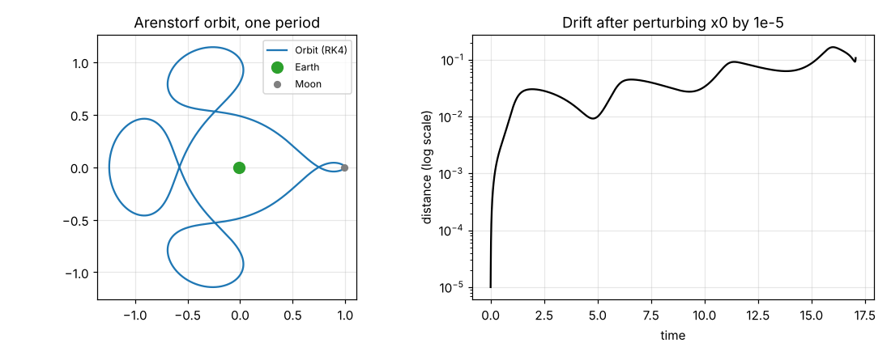
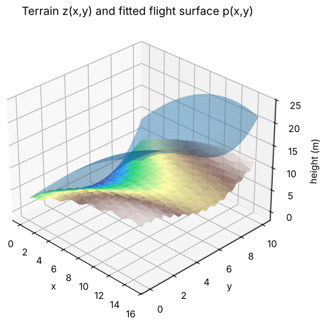
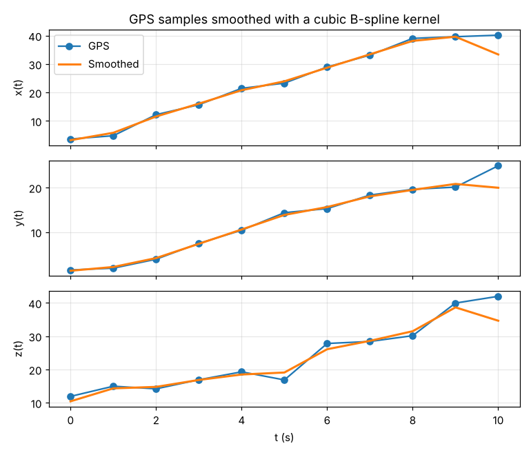
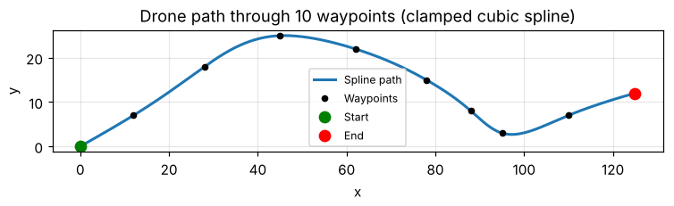

# Numerical Methods for Drone and Satellite Trajectories (MATLAB)

Numerical analysis applied to two motion problems: planning and reconstructing a **drone's flight**, and simulating a **satellite orbit** in the Earth–Moon system. Everything is implemented by hand in MATLAB: quadrature, constrained least squares, spline interpolation, kernel smoothing, finite differences and Runge–Kutta integrators.

Group project for *Numerical Analysis* (Instituto Superior Técnico, 2025).

## What's inside

### 1. Flight surface over a terrain — `1-terrain-approximation/`
Fits a cubic polynomial surface p(x, y) so the drone keeps a safe height above a bumpy terrain z(x, y). The weighted least-squares problem is assembled with **6-point Gauss–Legendre quadrature** in 2D, and two point constraints are imposed with **Lagrange multipliers** (KKT system).

### 2. Cleaning noisy GPS data — `2-gps-filtering/`
Smooths 11 noisy GPS samples with a **cubic B-spline kernel** (discrete convolution), estimates the drone's **velocity** by differentiating the kernel, and its **acceleration** with a 5-point central finite difference.

### 3. Smooth path through waypoints — `3-spline-path/`
Builds a **clamped cubic spline** through 10 waypoints by solving the tridiagonal system for the second derivatives. Cubic splines minimise ∫‖r''(t)‖² dt, so the path has no sudden changes in velocity. The script also exports each piece as a LaTeX formula.

### 4. Satellite orbit and chaos — `4-satellite-orbit/`
Integrates the **restricted three-body problem** to reproduce the Arenstorf periodic orbit with **RK4**, verifies the convergence order of Euler, Heun (RK2) and RK4, and studies how a tiny change in the initial position grows over time.

Observed convergence orders (error against a reference solution with h = 10⁻⁶):

| Method | Theoretical order | Estimated order |
|---|:---:|:---:|
| Euler | 1 | 1.01 |
| Heun (RK2) | 2 | 2.00 |
| RK4 | 4 | 4.06 |

## Running it

Open MATLAB in the folder of the part you want and run:

| Part | Command |
|---|---|
| 1. Flight surface | `main_drone_improved` |
| 2. GPS smoothing | `smooth_gps_path`, `velocity_from_kernel`, `acceleration_finite_difference` |
| 3. Spline path | `spline_path` |
| 4. Satellite orbit | `orbit_rk4`, `convergence_order`, `sensitivity_analysis` |

The orbit scripts use a step of 10⁻⁴ over several periods, so they take a little while.

## Skills shown

Numerical integration (Gauss–Legendre) · constrained least squares · cubic splines · convolution filters · finite differences · ODE solvers (Euler, Heun, RK4) · convergence analysis · sensitivity to initial conditions · MATLAB

## Authors

Carolina Baptista and group colleagues, Instituto Superior Técnico.
